# DualRadio

**Wi-Fi + Bluetooth manager for the CardputerZero**, for running the built-in radio and a USB Wi-Fi/Bluetooth dongle side by side on the 320×170 screen.

<p align="center">
  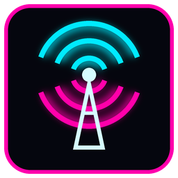<br>
  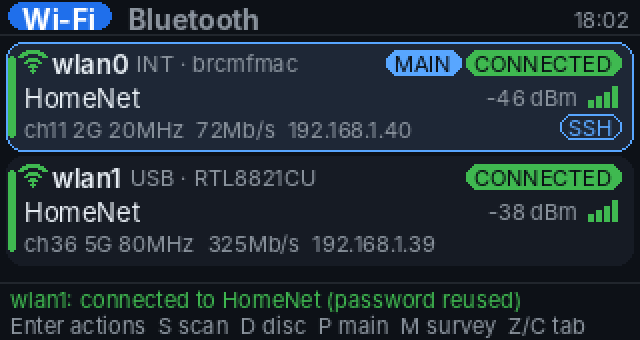
</p>

DualRadio started as an extended take on the store app *WiFi USB*. It adds:
- per-radio disconnect and forget
- remembered passwords that work on both radios
- band filtering
- a main-network selector
- automatic fallback to the built-in radio
- a duplicate-network guard
- monitor-mode surveys on both bands, with pcap capture
- a hotspot, ping and speed test
- a complete Bluetooth tool for each adapter

It's pure Python (Pillow, NetworkManager, `iw`, BlueZ over D-Bus), launched from APPLaunch.

---

## Contents
- [Features](#features)
- [Screenshots](#screenshots)
- [Themes and text size](#themes-and-text-size)
- [Keys](#keys)
- [Monitor-mode survey](#monitor-mode-survey)
- [Hidden networks](#hidden-networks)
- [Main network, fallback and duplicate guard](#main-network-fallback-and-duplicate-guard)
- [Supported hardware](#supported-hardware)
- [Install, update, remove](#install-update-remove)
- [Files and settings](#files-and-settings)
- [Troubleshooting](#troubleshooting)
- [Build from source](#build-from-source)
- [Licence and credits](#licence-and-credits)

---

## Features

### Wi-Fi (built-in `wlan0` + USB dongle)
| | |
|---|---|
| **Connect / disconnect** | Each radio separately, or both at once. |
| **Saved networks** | Per-radio profiles named `<ifname>-<ssid>`, compatible with *WiFi USB*. A password saved on one radio is reused on the other, so you're asked only once. **Forget** works per radio. |
| **Scan** | 2.4 / 5 GHz band filter. Combines NetworkManager's results with the kernel's, and runs a direct scan if those come back short, so the list isn't just the network you're connected to. |
| **Network details** | Channel, width, 802.11 standard (n/ac/ax), WPA2/WPA3, PMF, ciphers, clients and channel load, country, WPS router make and model, and every access point address (BSSID) with its maker. |
| **Join hidden** | Enter the network name and password by hand. |
| **Main network** | Choose which radio other apps use (route metric 110 vs 400, plus DNS priority). |
| **Auto-fallback** | Unplug the dongle and the built-in radio rejoins a saved network. |
| **Duplicate guard** | The dongle never sits on the same network and band as the built-in radio. It moves to the other band, or disconnects. |
| **SSH aware** | Warns before any action that would drop the radio carrying your SSH session. |
| **Monitor mode** | Survey of every band with access points, clients, channel lock and pcap recording, or plain monitor mode left on for other tools (airodump-ng, Kismet, Wireshark). |
| **Hotspot** | From the built-in radio, sharing the dongle's internet connection. |
| **Test** | Ping (loss, jitter) and a download speed test, bound to one radio. |
| **2.4 GHz overlap warning** | Shown when both radios use 2.4 GHz on channels that overlap. |

### Bluetooth (built-in `hci0` and dongle `hci1`, separately)
| | |
|---|---|
| **Scan** | Classic + BLE, with live signal strength and a "named only" filter. |
| **Details** | Device class, BLE appearance, services, manufacturer, decoded iBeacon / Apple / Microsoft adverts, TX power and an estimated distance. |
| **Pair** | Passkey confirm or PIN on screen, then connect, trust, remove. |
| **Hunt** | A live signal graph for finding a device by walking around. |
| **Power** | On/off per adapter. Unblocks rfkill, with a `btmgmt` fallback. |

---

## Screenshots
Rendered with the built-in preview (`src/preview.py`), Slate theme, shown at 2×.

| | |
|---|---|
|  **Home**: both radios, main network, SSH, chip | 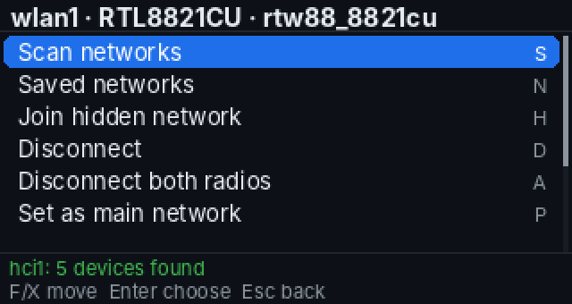 **Radio menu** (Enter) |
| 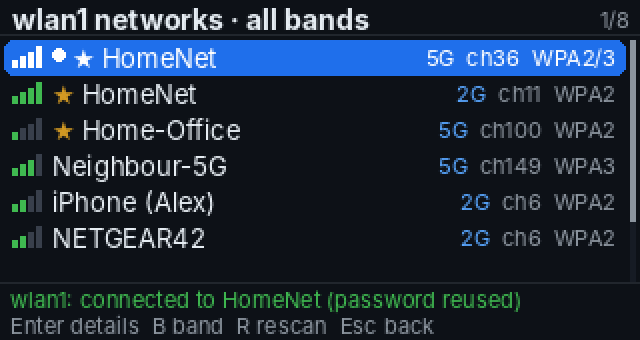 **Scan** with band filter | 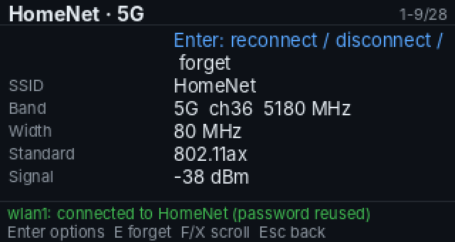 **Network detail** |
| 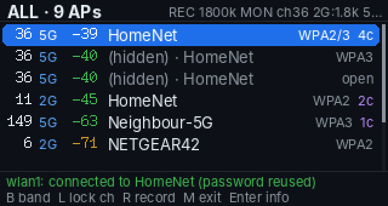 **Monitor survey**, with hidden networks linked to their router | 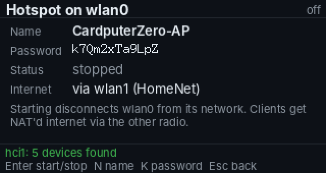 **Hotspot** |
| 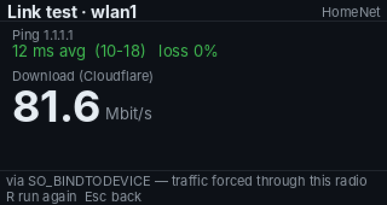 **Ping + speed test** | 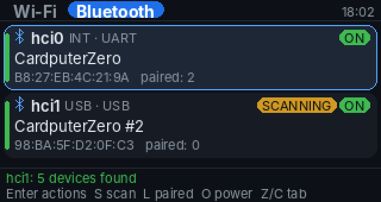 **Bluetooth adapters** |
| 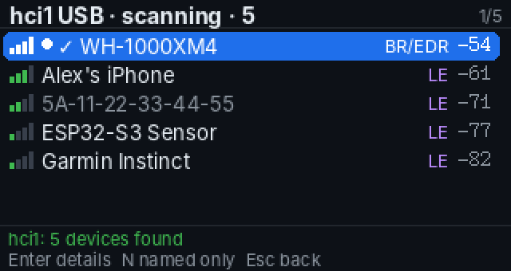 **BT scan** | 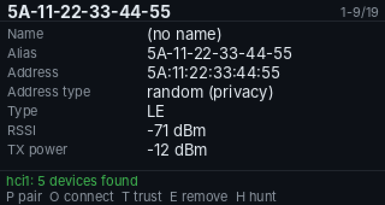 **BT device detail** |
| 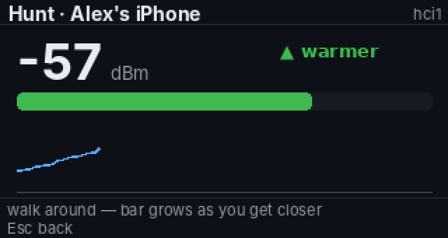 **Hunt** | 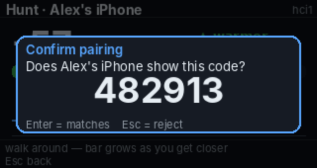 **Pairing confirm** |

---

## Themes and text size
**Y → Settings → Theme** cycles through the themes; **Text size** switches between Normal and Large. Both are saved.

| Slate (default) | Neon | Daylight |
|---|---|---|
|  | 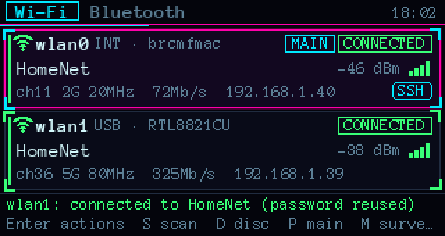 | 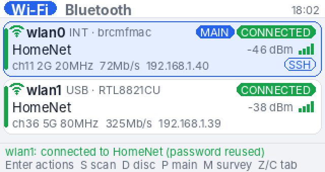 |
|  | 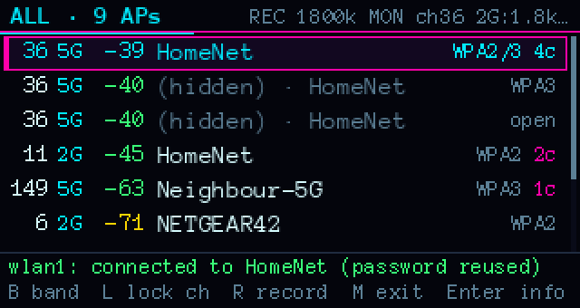 | 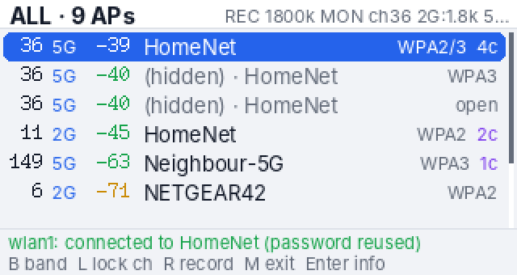 |
|  | 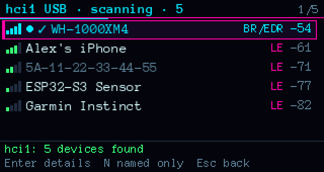 | 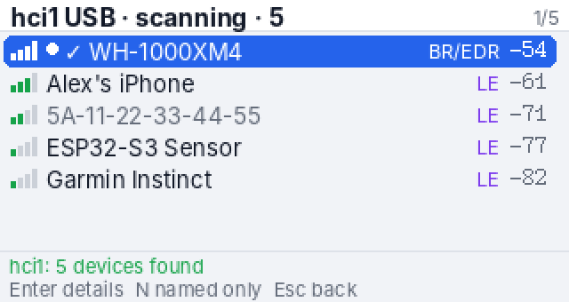 |
| Dark, Inter font, coloured status stripes | Cyberpunk, Anonymous Pro monospace font | Light and high-contrast for outdoors |

Large text (Slate):

| | |
|---|---|
| 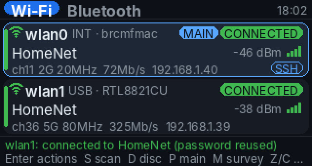 | 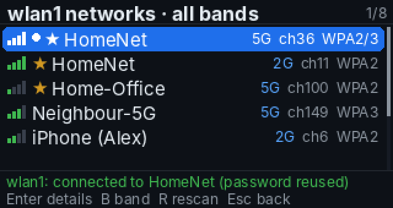 |

Every theme's screens are in [`docs/screenshots/`](docs/screenshots/).

---

## Keys
Arrows work **without Fn**: **F** up · **X** down · **Z** left · **C** right. Fn+F/X/Z/C and j/k also work.

### Everywhere
| Key | Action |
|---|---|
| F / X | Move up / down, or scroll |
| Z / C | Switch tab (Wi-Fi ↔ Bluetooth) |
| Enter | Select / open actions |
| Esc | Back |
| hold Esc | Exit to the launcher |
| Y | Settings (home screen) |

### Home: Wi-Fi tab
| Key | Action |
|---|---|
| Enter | Radio menu (below) |
| S | Scan networks |
| D | Disconnect this radio |
| P | Make this radio the main network |
| M | Monitor survey |

### Radio menu (Enter on a radio)
| Key | Item |
|---|---|
| S | Scan networks |
| N | Saved networks (E = forget) |
| H | Join hidden network |
| D | Disconnect |
| A | Disconnect both radios |
| P | Set as main network |
| M | Survey: APs, clients, capture (radios that support monitor mode) |
| (no key) | Raw monitor ON / OFF (leave the dongle in monitor mode for other tools) |
| O | Hotspot (radios that support AP mode) |
| T | Ping + speed test |

### Network list and detail
| Key | Action |
|---|---|
| B | Band filter: All → 2.4 → 5 GHz |
| R | Rescan |
| Enter | Details → connect. On the network you're connected to: Reconnect / Disconnect / Forget |
| E | Forget on this radio |

### Monitor survey
| Key | Action |
|---|---|
| B | Band: All / 2G / 5G (only bands the dongle supports) |
| L | Lock to one channel (pick from a list), or resume hopping |
| R | Start / stop pcap recording to `~/captures/` |
| Enter | Access point detail: over-the-air data plus a client list with makers |
| M / Esc | Leave. You're asked whether to keep the dongle in monitor mode for other tools |

### Bluetooth
| Key | Action |
|---|---|
| S / L / O | Scan / paired devices / power on-off (home tab or adapter menu) |
| N | Named devices only (scan list) |
| P / O / T / E / H | Pair / connect / trust / remove / hunt (device detail) |

### Settings (Y)
| Key | Item |
|---|---|
| Y | Theme: Slate → Neon → Daylight |
| T | Text size: Normal / Large |
| G | Duplicate guard on/off |
| R | Re-test dongle survey modes |

---

## Monitor-mode survey
The survey lists every access point it hears: channel, band, signal (live, min and max), security, standard, width, clients, data traffic, country, channel load and WPS model. **Enter** shows an access point's clients with their makers. **R** records a pcap file (radiotap headers, link type 127) that opens in Wireshark.

There are two capture methods. The app picks one per chip and remembers it in `/etc/dualradio/caps.json`:

| Method | How it works | When |
|---|---|---|
| **True monitor** | The dongle switches to monitor mode and hops channels (0.3 s per channel) | Default, on every band |
| **Scan-sweep** | The dongle stays connected and runs passive scans, while a listen-only `drmon<N>` interface captures | Fallback for chips that hear nothing on 2.4 GHz in monitor mode |

**Realtek RTL8821CU / RTL8811CU (rtw88_8821cu):** these chips hear 2.4 GHz in monitor mode only straight after the dongle is plugged in. Once the dongle has been connected to a network, 2.4 GHz stays silent until it's replugged. DualRadio does that replug in software: it disables and re-enables the USB device through `/sys/bus/usb/devices/<dev>/authorized` before every survey that covers 2.4 GHz. That takes about 2 s, and the dongle keeps its name. If 2.4 GHz is still silent after the reset, the survey switches to scan-sweep automatically. Other chips get a one-time ~15 s test on their first survey. To run it again: **Settings → Re-test dongle survey modes**.

---

## Hidden networks
A hidden network doesn't broadcast its name, so DualRadio shows what it can:

- **Revealed name (purple):** picked up when a device joins the network or probes for it by name (association requests, probe requests and probe responses). To get one, lock the channel with **L**, then reconnect a phone or mesh node.
- **`(hidden) · HomeNet`:** an extra network broadcast by the same router as a named one, such as a mesh link, IoT network or guest network. The app matches it when it's on the same channel and its address (BSSID) is almost identical to the named network's, a pattern common on ISP routers (e.g. `be:12:34:56:78:96` → `ae:12:34:56:78:97`).
- **`(hidden) · Smart Innovation`:** no matching router, so the app shows the maker from the hardware address instead, typically a smart-home device's setup network. This needs the `ieee-data` package.

---

## Main network, fallback and duplicate guard
DualRadio installs nothing outside its own folders. These rules are kept in NetworkManager's own profiles, or run by the app itself:

| Rule | How | While the app is closed |
|---|---|---|
| **Main network** (P) | Every saved profile of the main radio gets route metric 110 and DNS priority 10; the other radio's profiles get 400 / 100. Wired Ethernet (metric 100) still wins. Saved in `/etc/dualradio/main`. | ✅ stays in effect: it's stored in the profiles |
| **Fallback** | When the dongle disconnects or is unplugged while the built-in radio is idle, the built-in radio joins a saved network. | NetworkManager's own auto-connect usually does this too, unless you disconnected the built-in radio by hand |
| **Duplicate guard** | If the dongle joins the same network on the same band as the built-in radio, it moves to the network's other band when that exists, or disconnects. Can be turned off in Settings. | ❌ only checked while the app is open |
| **ARP fix** | `arp_ignore=1` / `arp_announce=2`, so two radios on one subnet each answer for their own IP address (otherwise SSH sessions can freeze). | Set at runtime each time the app starts; cleared by a reboot until the app is opened again |

---

## Supported hardware
Bands, monitor mode, AP mode and Bluetooth are detected at runtime, so dongles other than these work too. Features a dongle doesn't support are hidden or greyed out.

| Device | Chip | USB ID | Wi-Fi | BT | Tested |
|---|---|---|---|---|---|
| CardputerZero built-in | Broadcom (brcmfmac) | SDIO | 2.4 GHz | hci0 | ✅ |
| TP-Link Archer T2UB Nano v1 | RTL8821CU | `0bda:c820` | 2.4 + 5 GHz | hci1 | ✅ |
| BrosTrend AC650 (AC5L) | RTL8811CU | `0bda:c811` | 2.4 + 5 GHz | — | ✅ |
| MediaTek MT7921AU / MT7612U / MT7610U / MT7601U, Atheros AR9271, Ralink RT5370 / RT3070 | (recognised by USB ID) | | | | not yet |

To see which chip you have: `lsusb`, then compare against the table. The home screen shows the chip under each radio.

---

## Install, update, remove
From the **CardputerZero app store**, or manually:

```bash
# from your computer
scp dualradio_1.4.2_arm64.deb <user>@<zero-ip>:/tmp/
# on the Zero
sudo apt install /tmp/dualradio_1.4.2_arm64.deb
```
Updating works the same way with a newer `.deb`. To remove it: `sudo apt remove dualradio`.

Requires Pi OS (Bookworm/Trixie, arm64) with NetworkManager, BlueZ and `iw`. Debian dependencies are installed automatically. It can coexist with *WiFi USB*.

**Admin rights:** DualRadio has to run as root to control the radios. Most CardputerZeros already have passwordless `sudo` for the device user (set when the image is flashed), so it just works. If the app instead opens to a **"needs admin rights"** screen — which happens on devices where that wasn't set up, e.g. a custom username — run its one-time setup over SSH, then relaunch from the menu:
```bash
sudo sh /usr/share/APPLaunch/apps/dualradio/setup-sudo.sh
```

**Upgrading from 1.3.x:** 1.4.0 no longer installs system hook files (the app store doesn't allow them), but dpkg keeps the old ones. Remove them once:
```bash
sudo rm -f /etc/NetworkManager/dispatcher.d/90-dualradio /etc/sysctl.d/90-dualradio-arp.conf /etc/sudoers.d/dualradio
```

---

## Files and settings
| Path | Purpose |
|---|---|
| `/usr/share/APPLaunch/apps/dualradio/` | the app |
| `/usr/share/APPLaunch/applications/dualradio.desktop` | launcher entry |
| `/etc/dualradio/main` | main network: `internal` or `usb` |
| `/etc/dualradio/nodup` | duplicate guard on/off |
| `/etc/dualradio/theme`, `textsize` | appearance |
| `/etc/dualradio/caps.json` | survey capabilities per chip |
| `/usr/bin/dualradio-cli` | command-line helper (`dualradio-cli --help`) |
| `/var/log/dualradio.log` | log |
| `~/captures/dualradio-*.pcap` | survey recordings |

---

## Troubleshooting
| Symptom | Check |
|---|---|
| Survey hears nothing on 2.4 GHz | `grep -E "usb_reset\|survey (wlan\|wlx)\|probe\|reset24" /var/log/dualradio.log \| tail -12` |
| Scan shows only the network you're connected to | `grep "scan wlan0" /var/log/dualradio.log \| tail -3` (shows NM / kernel cache / direct counts) |
| Which hidden names were revealed | `grep revealed /var/log/dualradio.log` |
| Dongle Bluetooth won't power on | `rfkill list; bluetoothctl list` |
| Stuck on "loading", or a "needs admin rights" screen | No passwordless `sudo` for your user. Run once: `sudo sh /usr/share/APPLaunch/apps/dualradio/setup-sudo.sh`, then relaunch. Check the `dualradio launch` line in the log for `uid`/`euid` |
| Wrong radio used for internet | `ip route` (main radio = metric 110) |
| Survey settings stuck | Settings → Re-test, or `sudo rm /etc/dualradio/caps.json` |

---

## Build from source
```bash
./build.sh                       # -> dist/dualradio_<ver>_arm64.deb
python3 src/preview.py           # renders every screen to ./preview/ (no hardware needed)
python3 test/test_netcore.py     # nmcli/iw parsing, connect/forget/main/duplicate guard/watcher (simulator)
python3 test/test_flows.py       # UI flows with mocked radios and BlueZ
python3 test/test_uncloak.py     # radiotap/802.11 parsing, hidden-SSID reveal, router matching
python3 test/test_fallback24.py  # 2.4 GHz silence → USB reset → sweep fallback, usb_reset on fake sysfs
```
Layout: `src/dualradio.py` (UI), `src/netcore.py` (Wi-Fi engine), `src/moncore.py` (monitor survey), `src/btcore.py` (Bluetooth), `src/wifimgr.py` (base helpers + CLI), `packaging/` (deb scripts, launcher wrapper, .desktop), `store/` (store icon and screenshots), `app-builder.json` (store metadata).

---

## Licence and credits
MIT, © Ricardo (RIAL0). Fonts: [Inter](https://rsms.me/inter/) (OFL, subset) and [Anonymous Pro](https://www.marksimonson.com/fonts/view/anonymous-pro) (OFL, shipped unmodified), with DejaVu used for symbols. Their licences are in `src/fonts/`.
